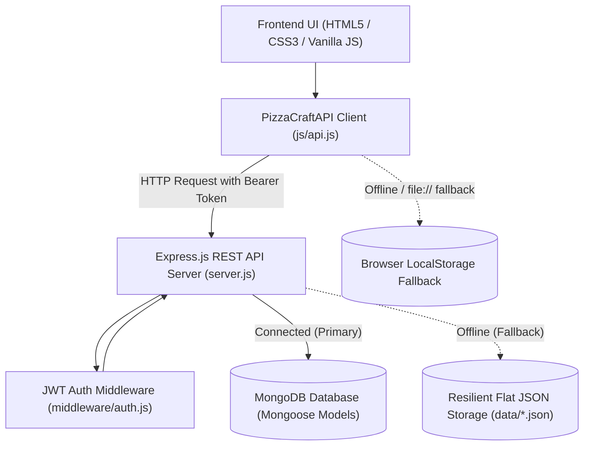

# 🍕 PizzaCraft — Artisanal Wood-Fired Pizza & Culinary Community Journal

[](https://nodejs.org/)
[](https://expressjs.com/)
[](https://www.mongodb.com/)
[](https://jwt.io/)
[](https://github.com/)
[](LICENSE)

PizzaCraft is a full-stack web application combining an **e-commerce pizza ordering experience** with an interactive **culinary community blogging platform**. Built with modern JavaScript, Node.js, Express, MongoDB, and secured with JSON Web Tokens (JWT).

---

## 🌟 Key Application Features

### 🛒 1. Artisanal Pizza Ordering & Customization
- **Interactive Pizza Customizer Modal**: Real-time crust selection (72-hr Sourdough, Thin Crust, Cheese Burst), size choices (8", 10", 12"), and gourmet toppings with dynamic price calculation.
- **In-Card Quantity Controllers**: Direct `[-] [qty] [+]` controls on menu cards for fast ordering.
- **Cart Slide-Over Drawer**: Visual free-delivery progress tracker (unlocks free shipping at ₹499) and promo coupon redemption (`PIZZA20`, `FREESHIP`).
- **Real-Time GPS Delivery Tracker**: 4-stage tracking (*Order Placed ➔ Baking in Oven ➔ Out for Delivery ➔ Delivered*) with interactive stage progression simulation.

### ✍️ 2. Full CRUD Culinary Community Journal
- **Create**: Publish pizza stories, dough hydration secrets, and chef recipes with cover image presets.
- **Read**: Browse articles with reading time calculations, author avatars, and formatted paragraphs.
- **Update**: Dedicated [`edit-blog.html`](edit-blog.html) page with unsaved-changes detection, live character counters, and live cover preview.
- **Delete**: Soft and hard deletion with interactive confirmation modals.
- **Live Search & Filter**: Real-time keyword search across titles, content, categories, and authors with debounced input.
- **Category Filter Chips**: Filter stories by *Baking Secrets, Italian Heritage, Chef Tips, Ingredients, Health & Nutrition, World Flavors*.
- **Interactive Story Likes**: Heart appreciation toggle with instant like count updates.

### 🔒 3. Secure JWT Authentication & Customer Dashboard
- **JSON Web Tokens (JWT)**: Cryptographically signed tokens (`Bearer <token>`) securing private endpoints.
- **Password Security**: Passwords hashed using `bcryptjs` with salt work factor of 12.
- **Protected Private Dashboard**: Session verification prevents unauthorized access and provides 1-click Instant Demo Login.
- **User-Specific Content Filtering**: Dashboard displays **only the logged-in user's published blogs** with quick Edit and Delete controls.
- **Live User Profile Management**: Edit profile details (Name, Phone, Delivery Address) in real time with server-side persistence.
- **Instant Demo Login**: Pre-seeded with test user `john@example.com` / `pizza123`.

---

## 🏗️ Architecture & Dual-Storage Pattern

PizzaCraft features a resilient **dual-storage architecture** that ensures seamless operation both in development and production environments:



1. **MongoDB Primary**: When MongoDB is running (locally or on MongoDB Atlas), Mongoose models (`User`, `Blog`, `Order`) handle data persistence and validation.
2. **JSON File Fallback**: If MongoDB is unreachable, routes automatically fall back to persistent local JSON files (`data/users.json`, `data/blogs.json`, `data/orders.json`).
3. **Browser LocalStorage Fallback**: If opened as a local static file (`file:///`) or backend is offline, the frontend client seamlessly maintains cart, orders, and user sessions.

---

## 🛠️ Technology Stack

| Layer | Technologies |
|---|---|
| **Backend Runtime** | Node.js (v18+) |
| **Web Framework** | Express.js (v5.3.0) |
| **Database** | MongoDB & Mongoose ODM (v9.12.2) |
| **Authentication** | JSON Web Tokens (`jsonwebtoken`), `bcryptjs` |
| **Frontend** | HTML5, CSS3 (Custom Variables, Flexbox, CSS Grid), Vanilla JavaScript (ES6+) |
| **Styling & Design** | Custom Design System, Responsive Media Queries, Google Fonts (Poppins & Inter) |
| **Testing** | Native Node.js HTTP integration test suite (`test-api.js`) |
| **Deployment** | Render, Vercel, Netlify configurations included |

---

## 📡 REST API Reference

### 🔐 Authentication Endpoints (`/api/auth`)

| Method | Route | Access | Description | Request Body |
|---|---|---|---|---|
| `POST` | `/api/auth/register` | Public | Register new user & issue JWT | `{ name, email, password, phone, address }` |
| `POST` | `/api/auth/login` | Public | Authenticate user & issue JWT | `{ email, password }` |
| `GET` | `/api/auth/me` | **Protected** | Retrieve authenticated user profile | None (`Authorization: Bearer <token>`) |
| `PUT` | `/api/auth/profile` | **Protected** | Update user profile details | `{ name, phone, address }` |
| `POST` | `/api/auth/logout` | Public | Invalidate user session | None |
| `GET` | `/api/auth/users` | Public | List registered users (sanitized) | None |

### 📖 Blog Endpoints (`/api/blogs`)

| Method | Route | Access | Description | Query / Body |
|---|---|---|---|---|
| `GET` | `/api/blogs` | Public | List all blogs with search & filters | `?search=keyword&category=name` |
| `GET` | `/api/blogs/user/me` | **Protected** | List **only the logged-in user's** blogs | None (`Authorization: Bearer <token>`) |
| `GET` | `/api/blogs/:id` | Public | Get single blog article by ID | None |
| `POST` | `/api/blogs` | Optional Auth | Create & publish new pizza story | `{ title, category, author, content, image }` |
| `PUT` | `/api/blogs/:id` | Public | Update existing blog article | `{ title, category, author, content, image }` |
| `DELETE`| `/api/blogs/:id` | Public | Delete blog article | None |
| `POST` | `/api/blogs/:id/like` | Public | Increment or decrement like count | `{ action: "like" \| "unlike" }` |

### 📦 Order Endpoints (`/api/orders`)

| Method | Route | Access | Description | Query / Body |
|---|---|---|---|---|
| `GET` | `/api/orders` | Public | Retrieve order history | `?email=user@example.com` |
| `POST` | `/api/orders` | Public | Place a new pizza order | `{ items, subtotal, tax, deliveryFee, total, userEmail }` |
| `PATCH`| `/api/orders/:id/status`| Public | Advance live delivery status | None |

### 🛡️ Dashboard & System Endpoints

| Method | Route | Access | Description |
|---|---|---|---|
| `GET` | `/api/dashboard/stats` | **Protected** | Verify JWT session and return protected dashboard metrics |
| `GET` | `/api/health` | Public | Health check & database connection status |

---

## 🚀 Quickstart & Local Setup

### Prerequisites
- [Node.js](https://nodejs.org/) (v18.0.0 or higher)
- [npm](https://www.npmjs.com/) (v9.0.0 or higher)
- Optional: Local [MongoDB](https://www.mongodb.com/) daemon or [MongoDB Atlas](https://www.mongodb.com/atlas) connection URI

### 1. Clone & Install Dependencies
```bash
# Clone the repository
git clone https://github.com/your-username/pizzacraft.git
cd pizzacraft

# Install packages
npm install
```

### 2. Configure Environment Variables
Copy `.env.example` to `.env`:
```bash
cp .env.example .env
```
Ensure your `.env` contains:
```env
PORT=5000
MONGODB_URI=mongodb://127.0.0.1:27017/pizzacraft
JWT_SECRET=your_jwt_secret_key_here
JWT_EXPIRES_IN=7d
```

### 3. Seed Database (Optional)
```bash
npm run seed
```
Seeds initial demo users (`john@example.com` / `pizza123`) and authentic culinary blog articles.

### 4. Start the Application
```bash
# Production start
npm start

# Development mode with file watching
npm run dev
```

* Open your browser and navigate to: **`http://localhost:5000`**
* Test API health at: **`http://localhost:5000/api/health`**

---

## 🧪 Automated Test Suite

PizzaCraft includes a comprehensive automated test runner testing all auth, JWT, CRUD, search, filter, and ordering endpoints:

```bash
npm test
```

### Output:
```text
🍕 PizzaCraft Backend API Tests
=============================================
✅ [PASS] GET /api/health → 200 healthy
✅ [PASS] GET /api/health → includes database status
✅ [PASS] POST /api/auth/login → valid credentials
✅ [PASS] POST /api/auth/login → issues signed JWT token
✅ [PASS] POST /api/auth/login → returns safe user (no password)
✅ [PASS] POST /api/auth/login → wrong password returns 401
✅ [PASS] POST /api/auth/register → creates new user
✅ [PASS] POST /api/auth/register → issues signed JWT token
✅ [PASS] POST /api/auth/register → grants 120 loyalty points
✅ [PASS] POST /api/auth/register → 409 on duplicate email
✅ [PASS] POST /api/auth/register → 400 on short password
✅ [PASS] GET /api/auth/me (Protected) → 200 with valid JWT
✅ [PASS] GET /api/auth/me → returns authenticated user profile
✅ [PASS] GET /api/auth/me (Protected) → 401 when token is missing
✅ [PASS] GET /api/auth/me (Protected) → 401 with invalid token
✅ [PASS] PUT /api/auth/profile (Protected) → updates profile
✅ [PASS] PUT /api/auth/profile → returns updated name
✅ [PASS] GET /api/dashboard/stats (Protected) → 200 authorized
✅ [PASS] GET /api/dashboard/stats (Protected) → 401 unauthorized (Route Protected)
✅ [PASS] POST /api/auth/logout → 200 logged out
✅ [PASS] POST /api/blogs → creates story linked to user
✅ [PASS] GET /api/blogs/user/me (Protected) → returns user blogs
✅ [PASS] GET /api/blogs/user/me → contains logged-in user blog
✅ [PASS] GET /api/blogs → returns array of all articles
✅ [PASS] GET /api/blogs → contains published articles
✅ [PASS] GET /api/blogs/:id → returns single blog
✅ [PASS] GET /api/blogs/:id → correct blog title returned
✅ [PASS] GET /api/blogs/:id → 404 for missing blog
✅ [PASS] PUT /api/blogs/:id → updates blog
✅ [PASS] PUT /api/blogs/:id → returns updated title
✅ [PASS] DELETE /api/blogs/:id → deletes blog
✅ [PASS] GET /api/blogs/:id → 404 after deletion
✅ [PASS] GET /api/blogs?search=mozzarella → returns search results
✅ [PASS] GET /api/blogs?category=Baking+Secrets → category filter works
✅ [PASS] POST /api/blogs/:id/like → increments likes
✅ [PASS] POST /api/orders → places pizza order
✅ [PASS] PATCH /api/orders/:id/status → advances status
✅ [PASS] GET /api/nonexistent → 404 not found
=============================================
🏆 Results: 38/38 tests passed
🎉 All tests passed! PizzaCraft Auth & Dashboard module is fully functional.
```

---

## 🌐 Production Deployment Guide

### Option 1: Deploy to Render (Recommended)
1. Fork or push this repository to your GitHub account.
2. Sign in to [Render](https://render.com/).
3. Click **New +** ➔ **Web Service** and select your repository.
4. Render automatically reads [`render.yaml`](render.yaml):
   - **Build Command**: `npm install`
   - **Start Command**: `node server.js`
5. In the **Environment Variables** section, add:
   - `MONGODB_URI`: Your MongoDB Atlas connection string
   - `JWT_SECRET`: A secure random secret key
   - `JWT_EXPIRES_IN`: `7d`
6. Click **Deploy Web Service**.

### Option 2: Deploy to Vercel
1. Install Vercel CLI: `npm i -g vercel`
2. Run `vercel` from the project root directory.
3. The project includes [`vercel.json`](vercel.json) pre-configured to route API requests to `server.js` and serve static assets.
4. Add environment variables in the Vercel Dashboard under **Settings ➔ Environment Variables**:
   - `MONGODB_URI`
   - `JWT_SECRET`
   - `NODE_ENV=production`

### Option 3: Deploy to Netlify
1. Connect your repository in [Netlify](https://www.netlify.com/).
2. For serverless deployment with Express, use Netlify Functions or deploy the static frontend connecting to a deployed Render/Railway backend API by setting `API_BASE` in `js/api.js`.

---

## 📁 Project Directory Structure

```text
PizzaCraft/
├── config/
│   └── db.js                  # MongoDB & Mongoose connection with fallback
├── css/
│   └── style.css              # Vibrant theme stylesheet & responsive media queries
├── data/
│   ├── blogs.json             # Flat-file fallback storage for stories
│   ├── orders.json            # Flat-file fallback storage for orders
│   └── users.json             # Flat-file fallback storage for accounts
├── js/
│   ├── api.js                 # Centralized API fetch wrapper with JWT headers
│   ├── app.js                 # Global cart, drawer, floating UI, toasts & auth state
│   ├── auth.js                # Login, register, demo credentials & password toggle
│   ├── blog.js                # Blog CRUD, live search, categories & like actions
│   ├── dashboard.js           # Dashboard tracking, user-specific blogs & profile modal
│   └── menu.js                # Pizza customizer modal & quantity controls
├── middleware/
│   └── auth.js                # JWT verification middleware (protect & optionalAuth)
├── models/
│   ├── Blog.js                # Mongoose schema for blog posts
│   ├── Order.js               # Mongoose schema for orders
│   └── User.js                # Mongoose schema for users with bcrypt pre-save hook
├── routes/
│   ├── auth.js                # Auth REST routes (register, login, me, profile, logout)
│   ├── blogs.js               # Blog REST routes (CRUD, search, user-specific blogs)
│   └── orders.js              # Order REST routes (create, get, advance status)
├── .env.example               # Template environment configuration
├── blog-detail.html           # Single blog article view with likes, edit, delete & share
├── blog.html                  # Culinary journal with search, categories & action cards
├── create-blog.html           # Story publication form with live image preview
├── dashboard.html             # Customer dashboard with GPS tracker, profile & user blogs
├── edit-blog.html             # Dedicated edit article page with live character counters
├── index.html                 # Homepage with hero, specials, chef story & reviews
├── login.html                 # Customer sign-in page with 1-click demo login
├── menu.html                  # Menu catalog with filter categories & live customizer
├── package.json               # Scripts, engines, and project dependencies
├── register.html              # Account creation page with 120pts welcome bonus
├── render.yaml                # Render web service deployment blueprint
├── seed.js                    # Database seeder script
├── server.js                  # Main Express backend server
├── test-api.js                # Automated 38-case API test suite
└── vercel.json                # Vercel serverless deployment configuration
```

---

## 📄 License

This project is licensed under the **ISC License**. Created for the PizzaCraft Full-Stack Web Development Program.
